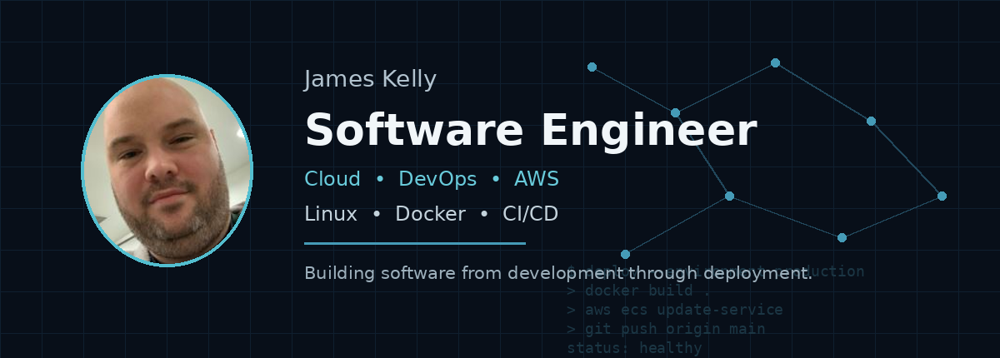

<h2 align="center">Software Engineer | Cloud & DevOps</h2>

<p align="center">
Software engineer with a background in full-stack development and computer science, with a growing focus on cloud infrastructure, DevOps, systems, and deployment automation.
</p>

<p align="center">
I enjoy understanding how applications work from development through deployment — building the software, containerizing it, deploying it to the cloud, automating the workflow, and troubleshooting when something doesn't work as expected.
</p>

<p align="center">
<a href="https://jk377y.dev">Portfolio</a> •
<a href="https://www.linkedin.com/in/james-kelly-cloud-engineer/">LinkedIn</a> •
<a href="mailto:jk377y@gmail.com">Email</a>
</p>

---

## About Me

- M.S. Computer Science — Computing Systems
- B.S. Software Engineering — Java
- AWS Certified Cloud Practitioner
- ITIL 4 Foundation
- Experience building and deploying full-stack applications
- Interested in Software Engineering, Cloud Engineering, DevOps, Systems Engineering, and SRE
- Currently expanding my knowledge of cloud infrastructure, networking, cybersecurity, and systems administration

I started primarily in web development, but my interests have increasingly moved toward the infrastructure and systems behind the application. I especially enjoy working with Linux, AWS, Docker, CI/CD pipelines, deployment automation, monitoring, and troubleshooting.

---

## Core Technologies

### Software Development

<p>

</p>

**Java • Python • JavaScript • Spring Boot • React • Node.js • Express • REST APIs**

### Cloud, DevOps & Systems

<p>

</p>

**AWS • Docker • Linux • GitHub Actions • CI/CD • Git • GitHub • SSH**

### Databases

<p>

</p>

**MongoDB • MySQL • PostgreSQL • DynamoDB • SQL**

---

## Selected Projects

### [Master Blaster Hub](https://github.com/jk377y/Master-Blaster-Hub)

Full-stack service management application built with **React, Java, Spring Boot, and MongoDB Atlas**.

The project includes JWT authentication, role-based access control, REST APIs, automated testing, Docker containerization, and a production AWS architecture using **ECS/Fargate, ECR, Application Load Balancer, S3, CloudFront, Route 53, and ACM**.

GitHub Actions workflows automated frontend and backend deployments.

**Focus:** Software Engineering • AWS • Docker • CI/CD • Full-Stack Development

---

### [ec2-monitoring-tool](https://github.com/jk377y/ec2-monitoring-tool)

A lightweight health dashboard for an **Amazon EC2 Linux** instance, deployed with a single command.

The main goal of this project is automation. Getting a tool like this onto a server normally means creating directories on the instance, copying files up one at a time, installing or checking dependencies, and starting each piece by hand. This project wraps all of that into one command, so nobody has to configure folders or upload files to the EC2 instance manually. You run bash `start.sh`, answer three prompts, and the launcher does the rest.

**Focus:** Bash • Linux/Windows/macOS • EC2 System Health Monitoring • Dashboard Display

---

### [AllClock](https://github.com/jk377y/AllClock)

Standalone Windows desktop application built with **Java 17 and JavaFX** for monitoring multiple time zones simultaneously.

Includes persistent user settings, window-state management, configurable time zones, and Windows packaging using Gradle and `jpackage`.

**Focus:** Java • JavaFX • Desktop Development • Application Packaging

---

## Certifications

- **[AWS Certified Cloud Practitioner](https://drive.google.com/file/d/1-InhBvrnwbNuklqRq5PpDNxY8zUF9VMg/view?usp=drive_link)** — Amazon Web Services
- **[ITIL 4 Foundation](https://drive.google.com/file/d/1XDLg4Wzx4NPbBiLVRfC8zJtsUTqD2OYY/view?usp=drive_link)** — PeopleCert
- **[Google IT Support Professional Certificate](https://drive.google.com/file/d/1kxUZWWzTeo8bNF0CQVIvxTJ_XTxD_3VE/view?usp=drive_link)** — Google
- **[Full Stack Web Development Certificate](https://drive.google.com/file/d/1T_nMmu6hVak21Ae0v0gJOS012-hFORng/view?usp=drive_link)** — University of Texas at Austin
- **[WGU Back-End Developer Certificate](https://drive.google.com/file/d/1p_YexhMkyoh3C5F_xVRC3-fIeXoz4hN_/view?usp=drive_link)** — Western Governors University
- **[WGU Front-End Developer Certificate](https://drive.google.com/file/d/1ZUx2duZribmJAI4EAM3yTYIyBJJJhkBb/view?usp=drive_link)** — Western Governors University

---

## Currently Exploring

```text
Cloud Infrastructure
DevOps & Automation
Linux & Systems Administration
Networking
Cybersecurity
Containerized Applications
CI/CD
```

---

<p align="center">
<strong>Software Engineering • Cloud • DevOps • Systems</strong>
</p>

<p align="center">
<a href="https://www.linkedin.com/in/james-kelly-cloud-engineer/">LinkedIn</a> •
<a href="https://jk377y.dev">Portfolio</a> •
<a href="mailto:jk377y@gmail.com">Email</a>
</p>